# Retail Sales, Customer Segmentation & Churn Prediction

**End-to-end analytics project on 1.07M real e-commerce transactions:** Python cleaning → PostgreSQL star schema → SQL analysis → RFM segmentation → leakage-safe churn model → revenue-impact estimate → 5-page Power BI report.

> **Headline:** the top 20% of customers drive 77% of revenue, £578K is at risk of churning in the next 90 days, and a targeted retention campaign is expected to recover ~£42K for £8.5K (≈4.0x ROI).

  

---

## 1. Problem
An online gift wholesaler sells to thousands of mostly-B2B customers in 40 countries. Revenue growth has stalled, and customers don't "cancel"; they simply stop ordering, so the business only notices churn months later. The team needs to know:

1. How are sales performing, and which products and markets drive them?
2. Who are the most valuable customers, and how are they behaving?
3. **Which customers are likely to stop buying, how much revenue is at risk, and who should we contact first?**

## 2. Data source
[Online Retail II](https://archive.ics.uci.edu/dataset/502/online+retail+ii), UCI Machine Learning Repository (CC BY 4.0): every transaction of a UK-based online retailer from **1 Dec 2009 to 9 Dec 2011**, split across two Excel sheets.

| Raw rows | Columns | Customers | Countries | Products |
|---|---|---|---|---|
| 1,067,371 | 8 | 5,852 identified + guests | 40 | 4,908 stock codes |

Raw data is not committed; `python -m src.download_data` fetches it.

## 3. Approach

```
Raw Excel (2 sheets)
   │  01_data_cleaning.ipynb   profiling → 8 logged cleaning steps → star schema (7 tables)
   ▼
data/processed/*.csv ──► PostgreSQL warehouse (PKs, FKs, indexes) ──► 14 SQL analysis queries
   │  02_eda.ipynb             trends, seasonality, Pareto, cohorts, geography, returns
   │  03_rfm_segmentation      RFM quintile scoring → 10 actionable segments
   │  04_churn_prediction      snapshot features → LightGBM → SHAP → revenue impact
   ▼
customer_insights.csv ──► Power BI (5 pages, 40+ DAX measures, What-if scenario)
```

### Data cleaning: problems found and fixed
| Issue | Impact | Fix |
|---|---|---|
| The two yearly sheets **overlap by 9 days** (1–9 Dec 2010) | 22,523 duplicated rows, **£377K revenue double-counted** | Kept the overlap from one sheet only |
| Exact duplicate lines | 11,812 rows | Removed |
| Non-product codes (postage, bank charges, Amazon fees, vouchers, tests) | 5,818 rows would distort product rankings | Moved to `fact_fees` |
| Cancellations (`C` invoices) | 17,914 lines | Moved to `fact_returns`; **net revenue = sales − returns** |
| Zero/negative price or quantity (write-offs, bad debt) | 5,964 rows | Removed |
| Missing Customer ID (**22.8% of lines, 13.1% of revenue**) | Dropping them would understate revenue | Kept as guest key `0`; excluded only from customer analytics |
| 1,212 stock codes with several descriptions | Inconsistent product names | Most frequent description per code |
| Customers who appear **only in returns** | PostgreSQL **foreign keys rejected** their rows | Added to `dim_customer` with `has_purchases = false` |
| Orders of 80,995 and 74,215 units cancelled within minutes | Inflated gross sales and customer value | Neutralised by using **net** values everywhere |

Full log: [`reports/data_quality_log.csv`](reports/data_quality_log.csv). Categories were not in the data, so they are derived from description keywords (`src/cleaning.py`).

### Churn model: designed to avoid leakage
- **Churn definition** (no subscriptions in retail): a customer active in the past 12 months who makes **no purchase in the next 90 days**.
- **Point-in-time features:** 26 behavioural features (recency, frequency, spend windows, buying rhythm, category breadth, return rate, seasonality) computed only from data *before* each cutoff.
- **Training:** 4 quarterly snapshots (Sep 2010 → Jun 2011). Model complexity chosen by **leave-one-snapshot-out cross-validation**.
- **Testing:** an **out-of-time** snapshot (Sep 2011) the model never saw.
- **Revenue impact:** expected recovery = P(churn) × quarterly value × save rate, counted over **90 days only** (conservative).

## 4. Key findings

**Sales**
- Net revenue **£18.9M** (gross £19.6M, returns £0.72M, 3.65% return rate) across 39,516 orders.
- Growth has stalled: **+2.3%** YoY (Jan–Nov 2011 vs 2010). Sep–Dec delivers **44.5%** of annual revenue.
- **21% of products generate 80% of revenue.** Orders cluster on weekdays 10:00–13:00, with almost no Saturday trading (B2B buying pattern).
- International orders average **£853 vs £464** in the UK (1.8×), but are only 14.5% of sales.

**Customers**
- **Top 20% of customers → 77% of net revenue.** Champions + Loyal are 34% of customers but **80% of revenue**.
- **27.6%** of customers never place a second order; only 21% of a typical new cohort buys again the following month.
- 1,213 customers in slipping segments (At Risk, Can't Lose Them, About to Sleep) hold **£1.64M** of lifetime revenue.

**Churn**

| Model (out-of-time test) | ROC-AUC | PR-AUC | Top-decile lift |
|---|---|---|---|
| Rule: "no order in 90 days" | 0.662 | 0.597 | 1.33 |
| Logistic regression | 0.770 | 0.725 | 1.58 |
| **LightGBM (selected)** | **0.767** | **0.731** | **1.64** |

LightGBM was kept for its higher PR-AUC and top-decile lift (what matters when only the top of the list is contacted), while logistic regression matched it on AUC, showing that the signal is mostly monotonic.

- **Drivers (SHAP):** number of orders in the last year, recent spend, and irregular buying rhythm.
- Single-order customers churn at **72%** vs **19%** for 8+ orders. Repeat buyers more than 2× past their usual reorder gap churn at **55%** vs **35%** when on rhythm.
- **Seasonality matters:** churn after a September snapshot was 42–49% vs 69% after December.

## 5. Business recommendations
1. **Two-tier retention campaign:** Tier 1 (852 customers, personal outreach) is expected to recover **~£42.4K in 90 days for £8.5K (4.0x ROI)**; Tier 2 (1,278 customers, automated email) adds ~£26K. Bottom 50% is not worth paid outreach.
2. **Fix the first-to-second order leak** with a post-first-order journey.
3. **Trigger win-back on personal rhythm** (1.5× usual gap) instead of a fixed inactivity rule.
4. **Launch retention before the gifting season** (late summer), when customers are most likely to return.
5. **Measure the true save rate** with a 10% control group.

Details, sensitivity and limitations: [`reports/business_recommendations.md`](reports/business_recommendations.md).

## 6. Tech stack
| Area | Tools |
|---|---|
| Data processing & EDA | Python, pandas, NumPy, Matplotlib, Seaborn, Jupyter |
| Database | PostgreSQL (star schema, constraints, indexes, views) |
| SQL techniques | CTEs, window functions (`LAG`, `NTILE`, `RANK`, running sums, moving averages), `FILTER`, cohort logic |
| Machine learning | scikit-learn, LightGBM, SHAP |
| BI | Power BI: Power Query, star-schema model, DAX time intelligence, What-if parameters, drill-through, bookmarks |

## 7. Screenshots

### Python analysis
| | |
|---|---|
| 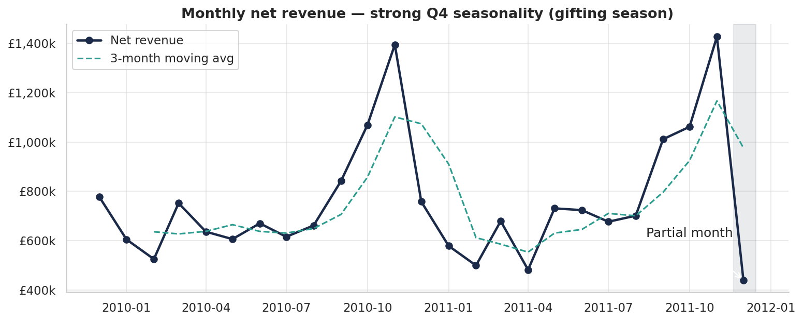 | 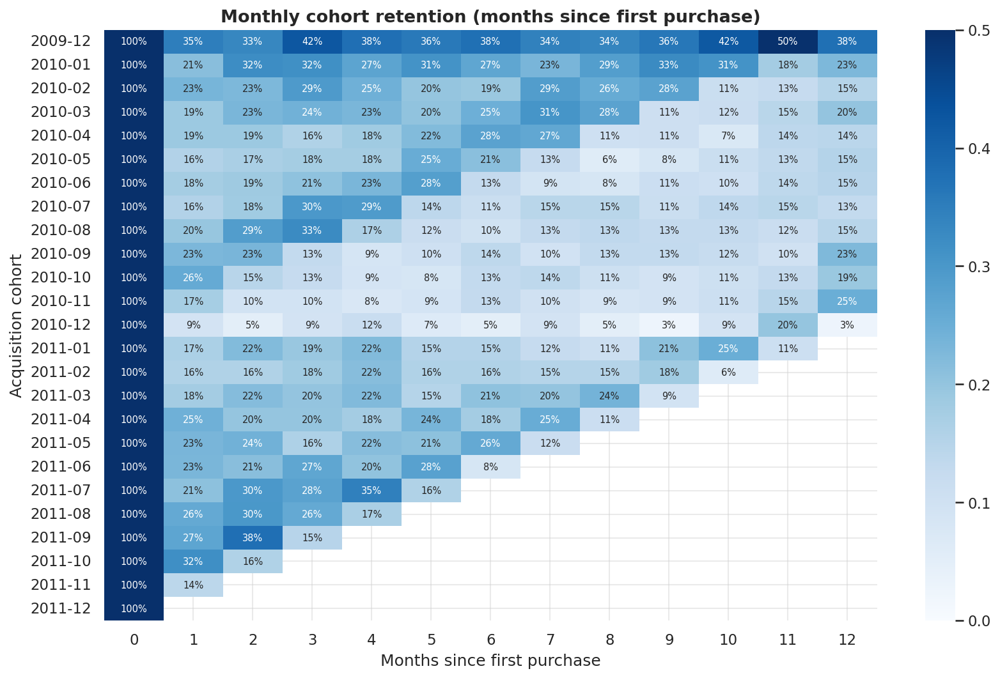 |
| 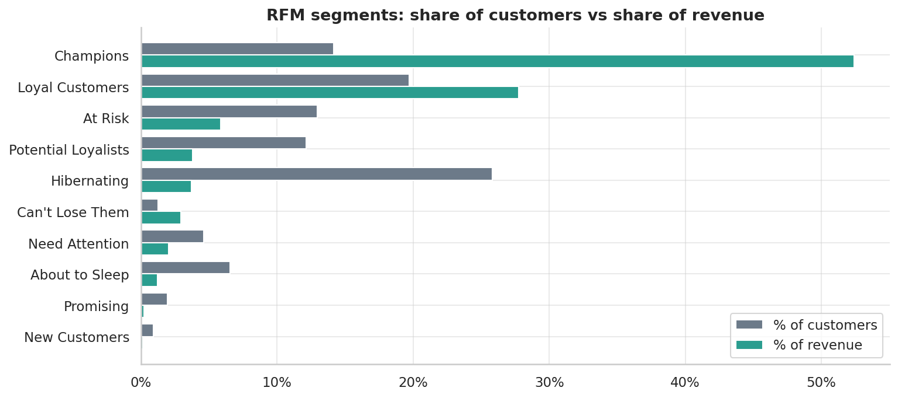 | 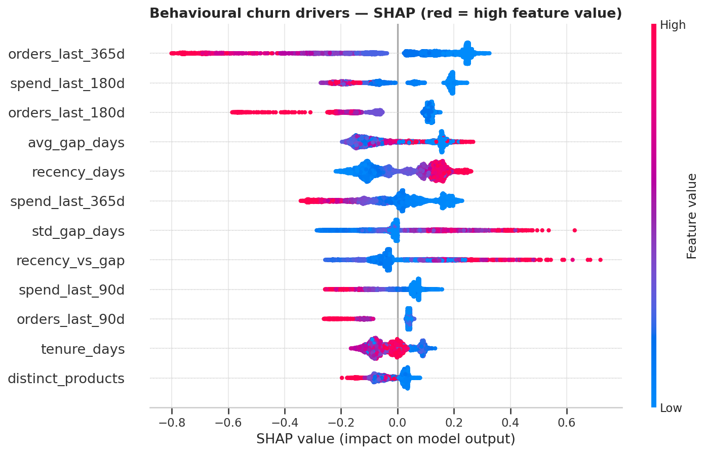 |
| 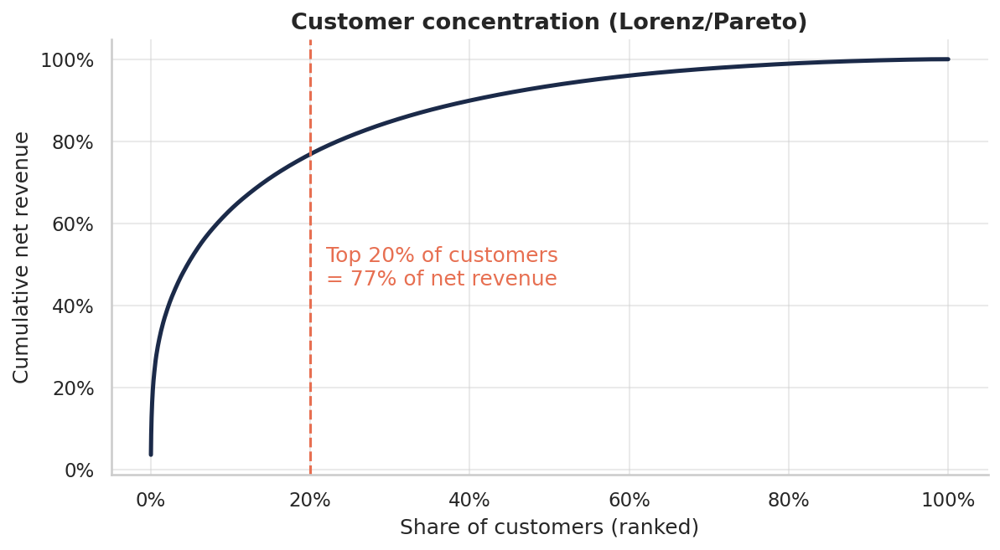 | 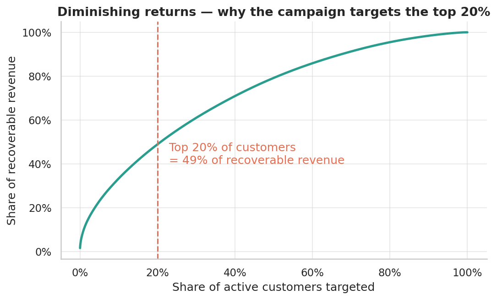 |

### Power BI report
| Page | Preview |
|---|---|
| Executive Overview | 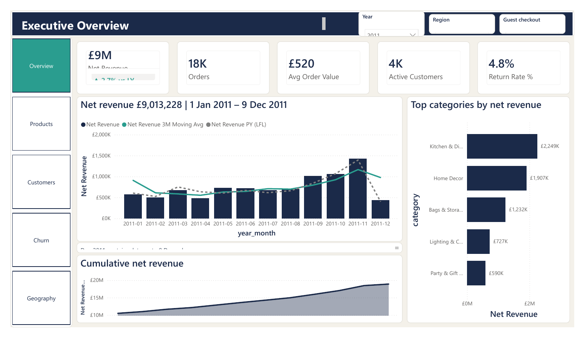 |
| Sales & Products | 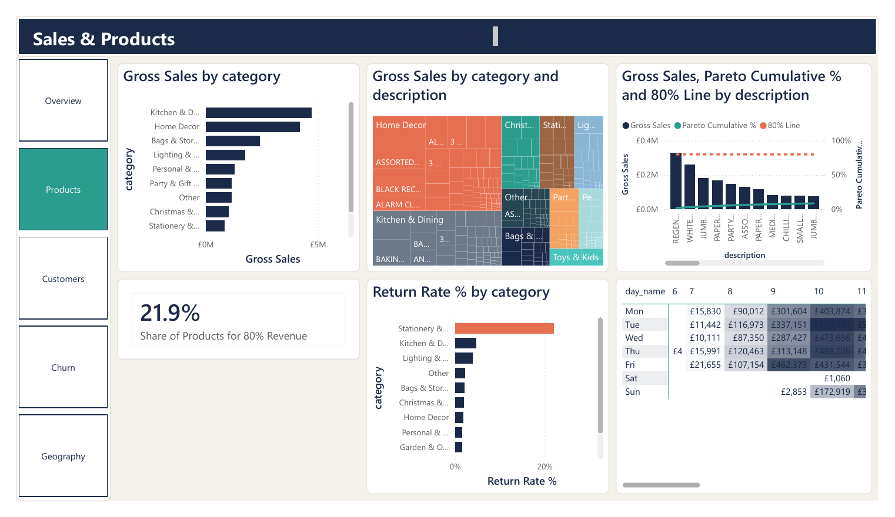 |
| Customers (RFM & Cohorts) | 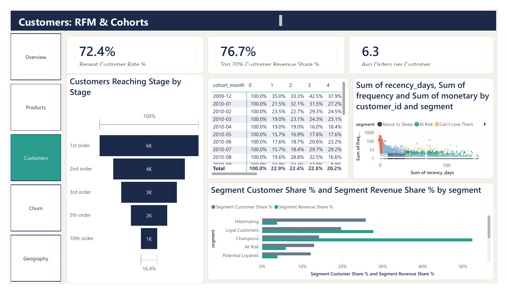 |
| Churn & Retention Campaign | 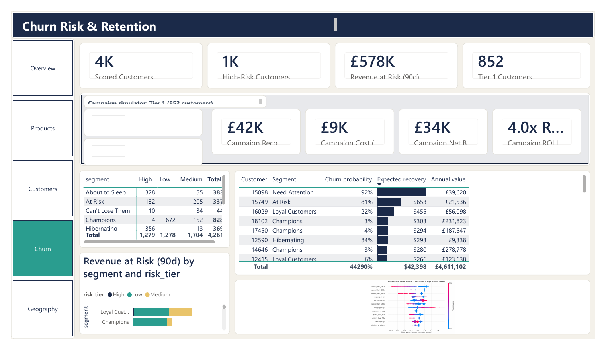 |
| Geography | 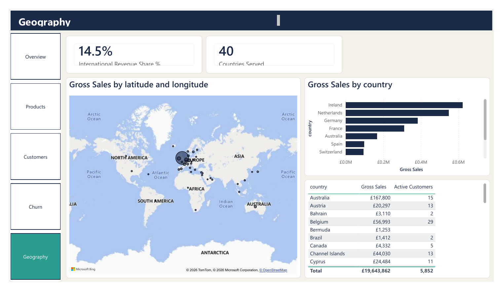 |

## 8. Power BI report
- **Report file:** [`powerbi/Retail_Retention_Analytics.pbix`](powerbi/Retail_Retention_Analytics.pbix) (open in Power BI Desktop; data is embedded)
- **PDF export of all 5 pages:** [`powerbi/Retail_Retention_Analytics.pdf`](powerbi/Retail_Retention_Analytics.pdf) (no Power BI needed)
- **Interactive features:** Year / Region / Guest slicers, a What-if campaign simulator (save rate, cost per customer), page navigator, conditional formatting driven by DAX measures, Top-N filters
- **Build notes:** [`DAX_measures.md`](powerbi/DAX_measures.md) · [`dashboard_build_guide.md`](powerbi/dashboard_build_guide.md) · [`chart_rationale.md`](powerbi/chart_rationale.md)

## Repository structure
```
├── notebooks/        01_data_cleaning · 02_eda · 03_rfm_segmentation · 04_churn_prediction
├── src/              config, cleaning, features, io, viz, download_data (reusable code)
├── sql/              01 schema · 02 load · 03 sales analysis · 04 customer analysis · 05 views
│   └── results/      saved output of every SQL query
├── powerbi/          .pbix report + PDF export · DAX_measures.md · build guide · chart_rationale.md · theme.json
├── data/processed/   star-schema CSVs (fact_sales split by year)
├── outputs/          RFM tables, key_metrics.json
├── reports/          data_quality_log.csv · business_recommendations.md
├── images/           all charts (Python + Power BI screenshots)
└── run_all.sh        rebuilds everything end to end
```

## How to run
```bash
git clone https://github.com/Karthik705/retail-customer-analytics && cd retail-customer-analytics
python -m venv .venv && source .venv/bin/activate   # Windows: .venv\Scripts\activate
pip install -r requirements.txt
python -m src.download_data                          # fetches the raw Excel file into data/raw/

createdb retail                                      # PostgreSQL
bash run_all.sh                                      # notebooks + warehouse + SQL analysis
# or: SKIP_SQL=1 bash run_all.sh                     # Python only
```
Then build the report with [`powerbi/dashboard_build_guide.md`](powerbi/dashboard_build_guide.md).

## Limitations & next steps
- No cost or margin data, so impact is measured in revenue, not profit.
- Save rate (15%) is an assumption; a control-group test would measure it.
- Categories come from keyword rules (~6% "Other"); a text classifier could improve this.
- Next: probability calibration per season, customer-lifetime-value model (BG/NBD), product recommendations for win-back offers.
