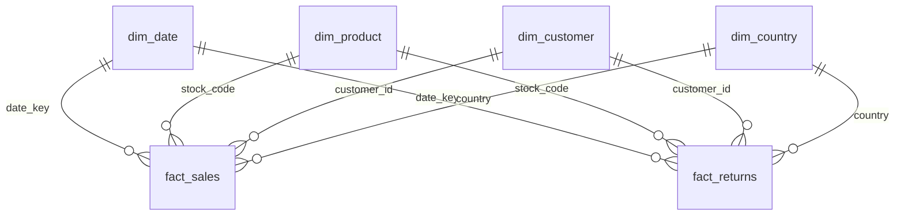

# Power BI Build Guide

How the 5-page report in `Retail_Retention_Analytics.pbix` was built, step by step, so it can be rebuilt from scratch from `data/processed/`.

Files used: everything in `data/processed/`, plus `powerbi/theme.json` and `powerbi/DAX_measures.md`.

---

## Step 1 · Import the data (Power Query)

1. **Home → Get data → Folder** → select `data/processed/fact_sales` → **Combine & Transform**. Rename the query to `fact_sales`. (The table is split into yearly files to stay under GitHub's size limit; the Folder connector stitches them back together.)
2. **Get data → Text/CSV** for: `fact_returns.csv`, `dim_customer.csv`, `dim_product.csv`, `dim_date.csv`, `dim_country.csv`, `customer_insights.csv`.
3. Click **Transform Data** before loading.

## Step 2 · Fix data types (the step most people skip)

| Column | Type | Why |
|---|---|---|
| `stock_code` (all tables) | **Text** | Codes like `85123A` exist; Power BI may auto-detect a number and turn them into errors |
| `invoice_no` | **Text** | Keep as an identifier, never summed |
| `customer_id` (all tables) | Whole number | Relationship key |
| `invoice_datetime` | Date/Time | |
| `date`, `first_purchase_date`, `cohort_month` | Date | |
| `cohort_index` | Whole number | |
| `line_value`, `unit_price`, money columns | Fixed decimal number | Avoids floating-point rounding in totals |

Then add a date column to **both** `fact_sales` and `fact_returns` (Add Column → Custom Column):

```m
= Table.AddColumn(#"Changed Type", "invoice_date", each DateTime.Date([invoice_datetime]), type date)
```

## Step 3 · Merge model output into the customer dimension

1. Select `dim_customer` → **Merge Queries** → `customer_insights` on `customer_id`, **Left Outer**.
2. Expand: `recency_days, frequency, monetary, R, F, M, RFM_score, segment, recommended_action, churn_probability, risk_tier, expected_quarterly_spend, annual_value, revenue_at_risk_90d, campaign_tier, expected_recovery`.
3. Right-click `customer_insights` → untick **Enable load** (it now lives inside `dim_customer`).

*Why merge?* A 1:1 relationship between two customer tables would need bi-directional filtering, which is slower and can be ambiguous. One wide dimension table is the standard star-schema practice.

**Close & Apply.**

## Step 4 · Model view

**Relationships** (all one-to-many, single direction, dimension → fact):

| From (1) | To (*) |
|---|---|
| `dim_date[date_key]` | `fact_sales[date_key]`, `fact_returns[date_key]` |
| `dim_product[stock_code]` | `fact_sales[stock_code]`, `fact_returns[stock_code]` |
| `dim_customer[customer_id]` | `fact_sales[customer_id]`, `fact_returns[customer_id]` |
| `dim_country[country]` | `fact_sales[country]`, `fact_returns[country]` |



Then:
- `dim_date` → **Mark as date table** (column `date`).
- `dim_date[month_name]` → **Sort by column** → `month_num`; `day_name` → sort by `day_of_week_num`.
- `dim_country[latitude]` / `[longitude]` → Data category **Latitude / Longitude**; `[country]` → **Country/Region**.
- Hide all key columns in report view (`date_key`, `*_line_id`, `cohort_index` stays visible).
- Set `dim_customer[customer_id]` → **Don't summarize**.

## Step 5 · Measures, parameters and helper table

1. Create the `_Measures` table and add every measure from `DAX_measures.md`, using the display folders listed there.
2. Create the two What-if parameters (`Save Rate`, `Cost per Customer`).
3. **Modeling → New table** for the funnel:
```DAX
Funnel Stages =
DATATABLE ( "Stage", STRING, "MinOrders", INTEGER,
    { { "1st order", 1 }, { "2nd order", 2 }, { "3rd order", 3 }, { "5th order", 5 }, { "10th order", 10 } } )
```
   Sort `Stage` by `MinOrders`. Do **not** relate it to anything: it's a disconnected table read by `[Customers Reaching Stage]`.
4. Check the validation table at the bottom of `DAX_measures.md` before building visuals.

## Step 6 · Theme and canvas

- **View → Themes → Browse for themes** → `powerbi/theme.json`.
- Canvas: 1280 × 720 (16:9). Use the same layout grid on every page: a 60px header band, KPI cards row, then the visual area.
- Add a slim **left navigation bar** with page-navigator buttons (Insert → Buttons → Navigator → Page navigator).

---

## Step 7 · Pages

### Page 1 — Executive Overview
*Question it answers: "How is the business doing and where should I look?"*

| Visual | Fields | Notes |
|---|---|---|
| 5 KPI cards (new Card visual) | Net Revenue, Orders, Avg Order Value, Active Customers, Return Rate % | Subtitle = `[YoY Label]`, coloured by `[YoY Colour]` |
| Line + clustered column chart | X `dim_date[year_month]`; columns `Net Revenue`; lines `Net Revenue 3M Moving Avg`, `Net Revenue PY (LFL)` | Add a text box with `[Partial Month Note]` |
| Area chart | `Net Revenue Running Total` by `year_month` | Shows cumulative growth |
| Small bar chart | `Net Revenue` by `dim_product[category]` (top 5) | Click-through entry point to page 2 |
| Slicers | `dim_date[year]`, `dim_country[region]`, `dim_customer[is_guest]` | Sync across pages (View → Sync slicers) |
| Title | `[Overview Title]` via Format → Title → fx | Dynamic: changes with slicers |

**Bookmarks on this page:**
- `Overview – Chart view` and `Overview – Table view`: two bookmarks that show/hide either the trend chart or a matrix (year_month × Net Revenue, PY, YoY %) in the same spot. Add two buttons that trigger them (Selection pane → hide/show, then Bookmarks → Add, untick *Data* so filters aren't saved).
- `Reset filters`: a bookmark captured with all slicers cleared, attached to a "Reset" button.

### Page 2 — Sales & Products
*Question: "Which products drive revenue, and which cause returns?"*

| Visual | Fields | Notes |
|---|---|---|
| Clustered bar | Gross Sales by `category`, sorted desc | Data labels in `£#,0,K` |
| **Treemap** | Group `category`, Details `description`, Values `Gross Sales` | Drill down from category to product |
| **Pareto combo** (line + column) | X `dim_product[description]`; column `Gross Sales`; line `Pareto Cumulative %` (secondary axis 0–100%) | Filter visual to Top N = 50 by Gross Sales; add constant line at 80% |
| Card | `Share of Products for 80% Revenue` | Expect ≈ 21% |
| Bar | `Return Rate %` by category, conditional colour via `High Return Flag` | Stationery shows ~22%: right-click → **Drill through → Product Detail** to show it's one cancelled 80,995-unit order |
| Matrix | `day_name` × hour (add a column in Power Query: `Time.Hour([invoice_datetime])`) with `Gross Sales`, background colour scale | Weekday × hour heatmap |

### Page 3 — Customers (RFM & Cohorts)
*Question: "Who are our customers, and do they come back?"*

| Visual | Fields | Notes |
|---|---|---|
| **Cohort heatmap** (Matrix) | Rows `dim_customer[cohort_month]` (format `yyyy-mm`), Columns `fact_sales[cohort_index]`, Values `Retention %` | Conditional formatting → background colour scale white→navy; filter `cohort_index` ≤ 12 |
| **RFM scatter** | X `recency_days`, Y `frequency` (log scale), Size `monetary`, Legend `segment`, Values `customer_id` | Set X/Y to *Don't summarize*; this plots one bubble per customer |
| **Funnel** | Category `Funnel Stages[Stage]`, Values `Customers Reaching Stage` | Expect 5,852 → 4,234 → 3,289 → 2,141 → 961 |
| Clustered bar | `Segment Customers` vs `Segment Revenue Share %` by `segment` | Customer share vs revenue share |
| Cards | `Repeat Customer Rate %`, `Top 20% Customer Revenue Share %`, `Avg Orders per Customer` | |

Add a text box under the cohort matrix: *"Dec-2009 cohort includes pre-existing customers (data starts 1 Dec 2009), so it looks more loyal than true new cohorts."*

### Page 4 — Churn Risk & Retention Campaign
*Question: "Who is about to leave, what is it worth, and what should we do?"*

| Visual | Fields | Notes |
|---|---|---|
| Cards | Scored Customers, High-Risk Customers, Revenue at Risk (90d), Tier 1 Customers | |
| **What-if sliders** | `Save Rate`, `Cost per Customer` | |
| Cards (scenario) | Campaign Recovery (scenario), Campaign Cost (scenario), Campaign Net Benefit, `Campaign ROI Label` | Moving the sliders updates every scenario card live |
| Matrix | Rows `segment`, Columns `risk_tier`, Values count of `customer_id` | Background colour scale |
| Stacked bar | `Revenue at Risk (90d)` by `segment`, legend `risk_tier` | |
| Table (call list) | `customer_id`, `home_country`, `segment`, `risk_tier`, `churn_probability`, `annual_value`, `expected_recovery`, `recommended_action` | Visual filter: `campaign_tier` = Tier 1; sort by `expected_recovery` desc; data bars on `expected_recovery` |
| Image | `images/14_churn_shap_summary.png` | "What drives churn": the model explanation from Python |

### Page 5 — Geography
*Question: "Where is the business outside the UK?"*

| Visual | Fields | Notes |
|---|---|---|
| **Map** (bubble) | Latitude/Longitude from `dim_country`, Size `Gross Sales`, Tooltip `Orders`, `Avg Order Value` | If maps are disabled: File → Options → Security → enable *Map and Filled Map visuals*, or use Azure Maps |
| Filled map (optional) | Location `dim_country[country]`, colour saturation `Gross Sales` | |
| Bar | Top 10 international markets (`is_domestic` = False) by Gross Sales | |
| Cards | `International Revenue Share %`, `Countries Served` | |
| Table | country, region, Gross Sales, Active Customers, Avg Order Value, `Market Rank` | International AOV ≈ 1.8× UK |

### Extensions (not in the published report)

The two drill-through pages and the tooltip page below are designed but not yet built into the `.pbix`.

#### Customer Detail (drill-through)
- Page settings → **Drill through**: add `dim_customer[customer_id]`; keep *Keep all filters* on.
- Title = `[Drillthrough Customer Title]`.
- Cards: segment, RFM_score, risk_tier, churn_probability, Net Revenue, Orders, `recommended_action` (use a multi-row card).
- Line chart: Net Revenue by `year_month` for this customer.
- Table: their top products (description, Units Sold, Gross Sales).
- Power BI adds a back button automatically.

**Test it:** right-click a customer in the Page 4 call list → Drill through → Customer Detail.

#### Product Detail (drill-through, hidden)
- Drill-through field: `dim_product[description]`. Hide the page (right-click the tab → Hide).
- Cards: Gross Sales, Returns Value, Return Rate %, Units Sold.
- Line chart: monthly Gross Sales vs Returns Value.
- Table: top customers buying this product.

#### Report-page tooltip
Create a small page (Page settings → Allow use as tooltip, canvas *Tooltip*) showing Net Revenue, Orders and Return Rate for a month. Set it as the tooltip of the Page 1 trend chart.

---

## Step 8 · Polish checklist
- [ ] Every visual has a title phrased as an insight or question, not "Sum of line_value".
- [ ] Consistent number formats (`£#,0,K` on charts, full numbers in tables).
- [ ] Slicers synced across pages 1–5.
- [ ] Interactions edited where cross-filtering is confusing (Format → Edit interactions).
- [ ] Alt text added to key visuals (accessibility; it also shows maturity).
- [ ] Performance Analyzer run once; no visual takes > 1s.
- [ ] Field list tidy: keys hidden, measures in folders.

## Step 9 · Export
**File → Export → Export to PDF** produces [`Retail_Retention_Analytics.pdf`](Retail_Retention_Analytics.pdf); the page images in `images/powerbi/` are rendered from that PDF.
